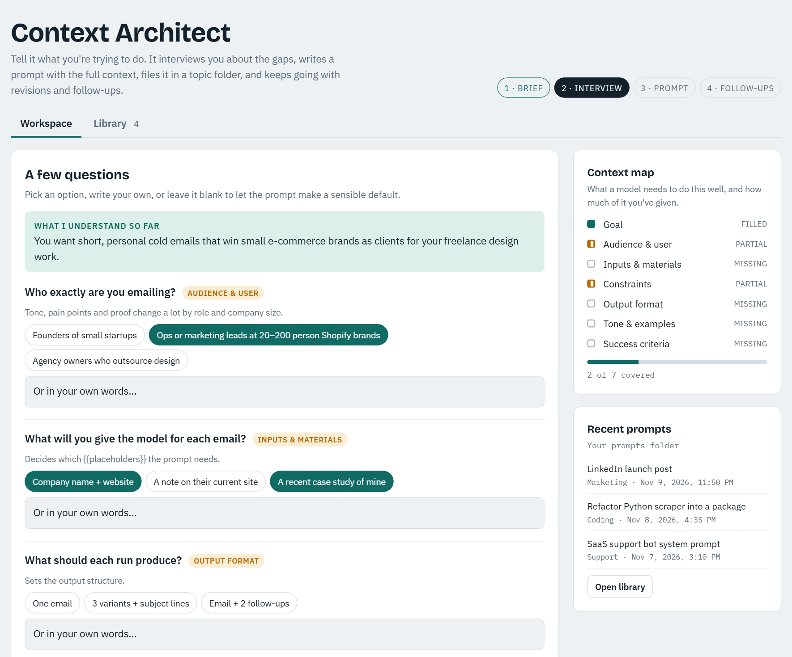
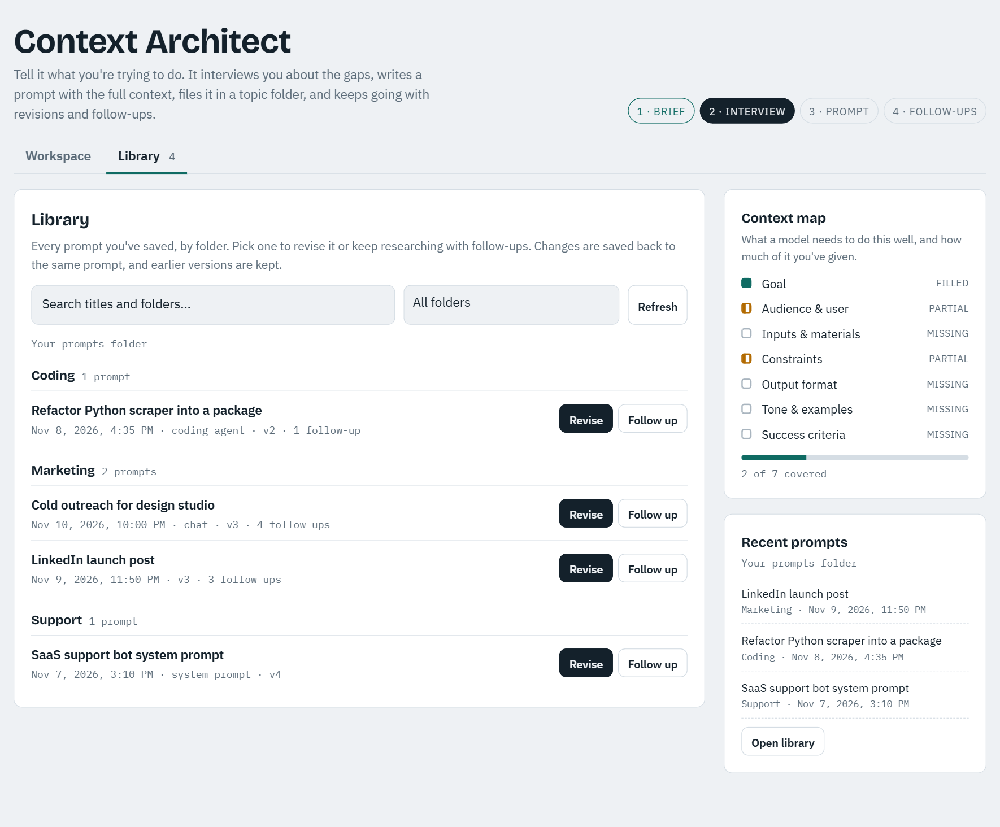
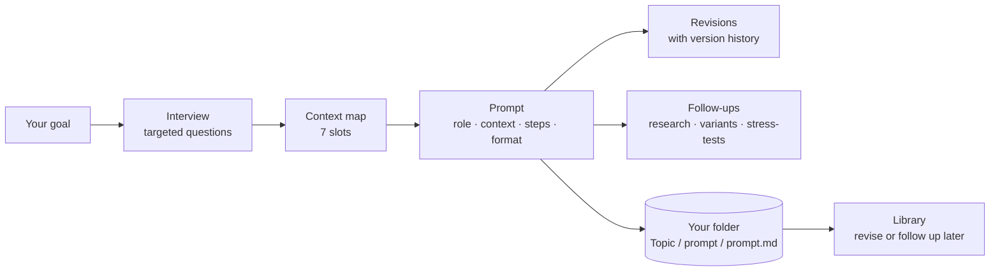

# Context Architect

**A prompt builder that interviews you before it writes anything.**

Most prompts fail because the model is missing context, not because the wording is off. Context Architect asks you the questions a good prompt engineer would ask, tracks what's still missing, and then writes a complete, context-rich prompt. It saves every prompt to a folder on your computer, so you can come back later to revise it or keep researching.



## Features

- **Interview first.** Describe your goal in a sentence. Claude restates it, then asks 3–8 specific questions, each with clickable answer options. You can skip any question and it will pick a sensible default.
- **Context map.** Tracks the seven things a model needs: goal, audience, inputs, constraints, output format, tone and examples, and success criteria. Each shows as filled, partial or missing.
- **Prompts you can reuse.** The output has a domain-specific role, structured sections (XML tags for LLMs, a dense description for image models), ordered steps, the reasons behind its rules, and `{{placeholders}}` for anything that changes each time you use it.
- **Revisions with history.** Ask for changes in plain words ("shorter", "add two examples"), or click **Edit text** and change the prompt yourself. Every earlier version is kept and can be restored.
- **Fill in the blanks.** Every `{{slot}}` in the prompt gets its own input box. Fill them in and click **Copy filled prompt** to get plain text that's ready to send. Finishing edits here helps because some chat apps turn long pastes into an attachment you can't edit.
- **Follow-ups you can keep using.** Keep researching the same task: *Research deeper*, *New variant prompt*, *Stress-test the prompt* or *Next-step prompt*. Each answer builds on every earlier one and suggests three questions to ask next.
- **Organized on disk.** Prompts are saved as `Topic folder / prompt name / prompt.md + session.json`. Claude suggests the topic folder, and you can move a prompt to another folder at any time.
- **Library.** Search every saved prompt by folder, then click **Revise** or **Follow up** to pick up where you left off.



## How it works



Context Architect is a single HTML page that runs as a [Claude artifact](https://claude.ai). Interviews and prompt writing use the viewer's own Claude account through the artifact runtime, so no API key is needed. Saving to disk goes through a small local MCP server (`server/context-folder-server.ps1`) that the Claude desktop app runs on your computer.

## Try it

**[Open Context Architect on Claude →](https://claude.ai/artifact/Wkqonifa7KC2pp6N4hBEbr)**

It runs on your own Claude account. In a web browser, the interview, prompts, revisions and follow-ups all work, and sessions are kept in that browser. Saving to a folder needs the Claude desktop app and the helper below.

To run your own copy, upload `context-architect.html` to Claude, ask it to publish the file as an artifact, and grant it the `sample` capability (plus `mcp` for folder saving, see [server/SETUP.md](server/SETUP.md)).

## Save prompts to a folder on your computer (optional)

The helper is a single PowerShell script with no dependencies. It can only:

- list, read and write `session.json` and `prompt.md` inside the one folder you choose;
- create topic folders there, and move a prompt between them.

It can't delete files, can't reach anything outside that folder, and never connects to the internet. Setup takes about two minutes: **[server/SETUP.md](server/SETUP.md)**.

## Use the interviewer anywhere

You don't need the app. [`meta-prompt.md`](meta-prompt.md) has the interviewer instructions. Paste them into ChatGPT, Gemini, Claude or any other chat assistant, add your goal at the end, and you get the same question-then-prompt flow.

## Project layout

```
context-architect.html            the app (one self-contained page)
server/context-folder-server.ps1  local MCP server for folder saving
server/SETUP.md                   how to connect it to the Claude desktop app
meta-prompt.md                    the interviewer as a copy-paste prompt
docs/                             screenshots
```

## Credits

Created by **atreyajayaram-sys**. Built with [Claude](https://claude.ai).

If you use Context Architect or build on it, please keep the license notice and link back to this repository. Stars, issues and ideas are welcome.

## License

[MIT](LICENSE) © 2026 atreyajayaram-sys
